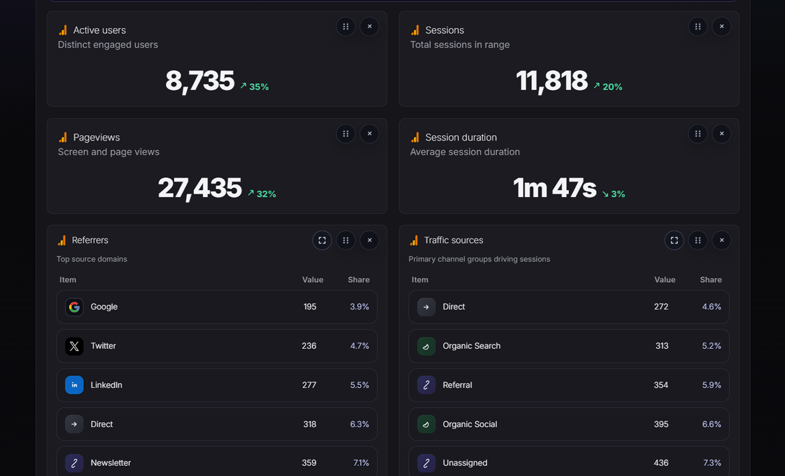
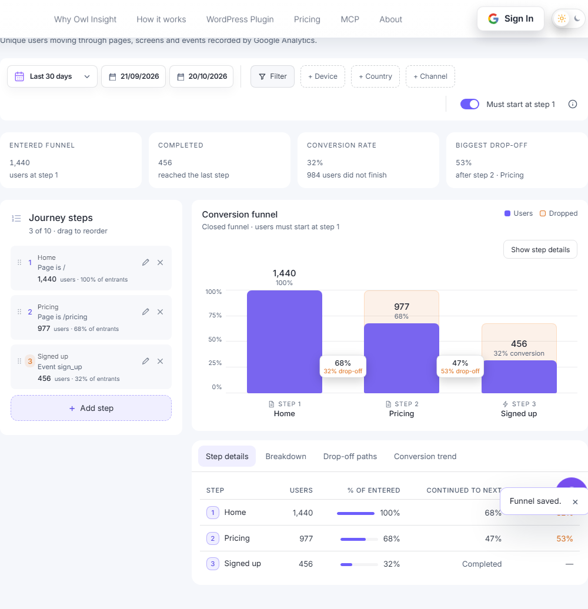
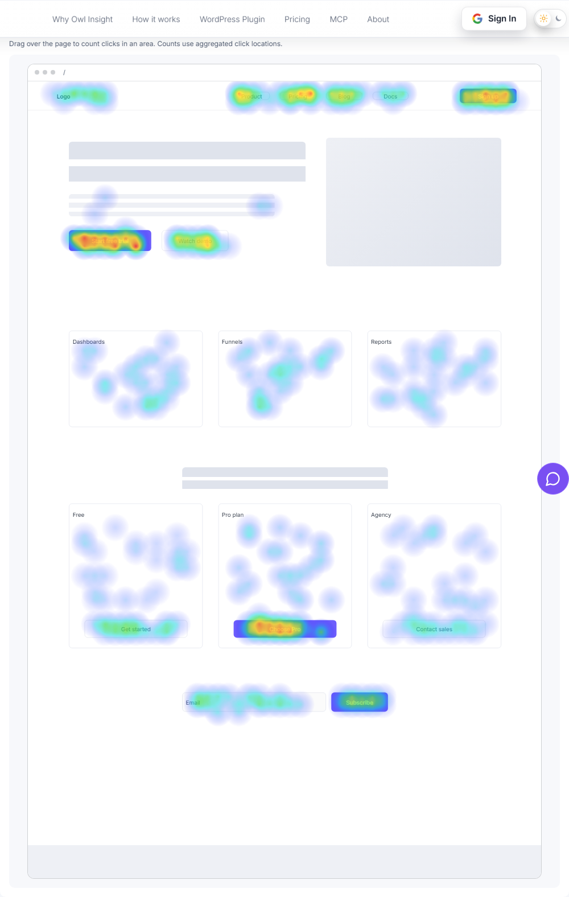

# OwlInsight Analytics

OwlInsight brings your existing Google Analytics 4 data into a dashboard for everyday reporting. Use it to see where traffic comes from, which pages people visit, and where they drop off.

[Website](https://owlinsight.dev/) · [Live demo](https://owlinsight.dev/demo) · [How it works](https://owlinsight.dev/how-it-works) · [Pricing](https://owlinsight.dev/pricing)

## What you can do

- **Reports.** Review visits, top pages, traffic sources, locations and devices. Compare date ranges and switch between properties.
- **Funnels.** Build a journey from pages, screens or GA4 events, such as landing page → pricing → sign-up. See how many users reach each step and where they leave.
- **Heatmaps.** See where people click and how far they scroll. Filter by page and device, fade the page preview, or drag across an area on the click map to count clicks.
- **Share and export.** Send a dashboard report link to a teammate or client, or export a report. See pricing for plan availability.

## Funnels

## Click and scroll heatmaps

## Try the workflows

Open the [live demo](https://owlinsight.dev/demo) and switch between **Reports**, **Funnels** and **Heatmaps**. The demo uses sample data and does not require sign-in.

For your own site, sign in and connect an existing GA4 property. Reports and funnels use your existing GA4 data. Heatmaps collect click and scroll data after you install the OwlInsight snippet on your site.

This repository contains public product documentation and screenshots. See the [product overview](./PRODUCT.md) for more detail.
